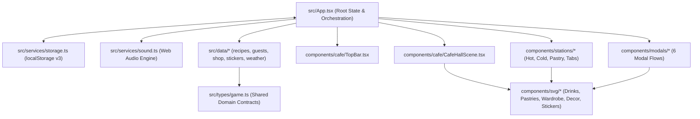
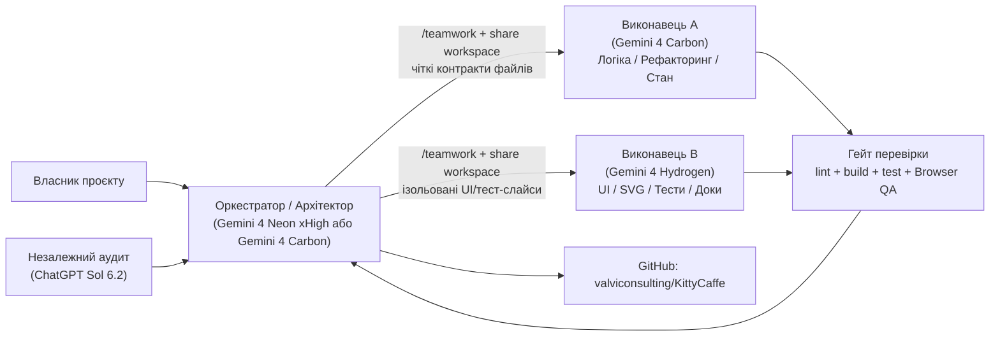

# Архітектура проєкту «Мур-Лате» (`KittyCaffe`)

> Документ описує поточну технічну архітектуру, доменні інваріанти, модель збереження даних, контракти верстки та процес мультиагентної розробки в **Google Antigravity**. Призначений як єдине джерело істини для Архітектора, Виконавців і зовнішніх аудиторів (зокрема **ChatGPT Sol 6.2**).

---

## 1. Продуктові інваріанти

1. **Цільова аудиторія**: дитина 9 років; затишна гра без програшу, без таймера зворотного відліку й без різких звуків чи покарань.
2. **Мова**: 100% українська в інтерфейсі, рецептах, діалогах, підказках і сповіщеннях.
3. **Художня система («Акварельна казка» / Studio Ghibli)**:
   - Теплий акварельний папір `#FAF4E8`, темно-коричневі контури `#5A3E32` (замість чорного `#000000`), пастельна шавлія `#BFD8C4`, медово-дерев’яна стільниця, рожевий `#F4C7D2`.
   - Шрифти Google Fonts: `Comfortaa` (інтерфейс) + `Caveat` (рукописні заголовки й крейдяна дошка).
4. **Автономність**: жодних зовнішніх бекендів чи зовнішніх медіа-URL; ілюстрації лежать локально в `public/assets/` із резервними inline-SVG, аудіо синтезується через Web Audio API.

---

## 2. Технологічний стек

| Шар | Технологія | Призначення |
| :--- | :--- | :--- |
| UI Framework | React `19.3` + TypeScript `~7.0` | Компонентна архітектура, сувора типізація |
| Build & Dev | Vite `8.3` (`@vitejs/plugin-react`) | Миттєвий HMR та production-збірка |
| Styling | Tailwind CSS `4.3` (`@tailwindcss/vite`) + `src/index.css` | Адаптивна верстка, акварельні текстури, 3D-дерев’яна стійка |
| Animation | Framer Motion `14.14` | Пружні натискання, дихання персонажів, плавні модалки (`MotionConfig reducedMotion="user"`) |
| Audio | Web Audio API (`src/services/sound.ts`) | Усі SFX (дзвіночок, пар, блендер, пічка, пензлик, стікер, муркотіння) + фонова музична скринька |
| Persistence | `localStorage` (`src/services/storage.ts`) | Ключ `mur_late_save_v1`, схема версії `3` зі зворотною сумісністю й санітизацією |
| Quality | `oxlint` + `tsc -b` + `tests/domain.test.mts` | Статичний аналіз, перевірка типів, доменні тести |

---

## 3. Схема модулів і потоків даних



### Структура директорій (`src/` та `public/`)

```text
KittyCaffe/
├── AGENTS.md                           # Завжди активні правила для агентів
├── docs/
│   ├── ARCHITECTURE.md                 # Цей документ
│   └── AUDITS.md                       # Журнал зовнішніх аудитів і тріажу
├── .agents/
│   └── skills/                         # Навички ролей (Architect, Executor, Audit, Visual QA)
├── .github/workflows/ci.yml            # CI: lint + build + test
├── tests/domain.test.mts               # Доменні модульні тести
├── public/assets/                      # Прозорі акварельні PNG (bg-cafe, marzipan, 7 guests)
└── src/
    ├── App.tsx                         # Кореневий стан, обробники, життєвий цикл замовлень
    ├── index.css                       # Тема, акварельні текстури, keyframes, landscape-правила
    ├── types/game.ts                   # Усі TypeScript-типи та схема збереження
    ├── config/assets.ts                # Маніфест шляхів до локальних ілюстрацій
    ├── data/
    │   ├── recipes.ts                  # Інгредієнти, рецепти, валідація (порядок не важливий)
    │   ├── guests.ts                   # Профілі 6 гостей + Котик-мандрівник, генератор замовлень
    │   ├── shop.ts                     # Каталоги гардероба, декору й відкривних рецептів
    │   ├── stickers.ts                 # 7 базових + 5 рідкісних золотих стікерів, побажання
    │   └── weather.ts                  # Конфіг погоди (сонячно / дощ / сніг)
    ├── services/
    │   ├── storage.ts                  # Завантаження, міграція, санітизація й запис localStorage
    │   └── sound.ts                    # Синтез SFX і циклу музичної скриньки (Web Audio API)
    └── components/
        ├── common/AssetIllustration.tsx # Відображення PNG із безшовним SVG-fallback
        ├── cafe/                       # TopBar, CafeHallScene, GuestCard, MarzipanHelper, ServingTray, WindowWeatherOverlay
        ├── stations/                   # StationTabs, HotDrinksStation, ColdDrinksStation, PastryStation
        ├── modals/                     # RecipeBookModal, LatteArtModal, TakeawayCupModal, SecretDrinkModal, ShopModal, FriendshipAlbumModal
        └── svg/                        # DrinkVisualSvg, PastryVisualSvg, TakeawayCupSvg, MarzipanAccessoriesSvg, CafeDecorAndSouvenirsSvg, UiIconsSvg та ін.
```

---

## 4. Архітектура стану та збереження

### Постійний стан (`CafeSaveState`, `version: 3`)
Зберігається під ключем `mur_late_save_v1` автоматично через `useEffect` у `App.tsx`:
- **Прогрес**: `coins`, `servedCount`, `weather`, `muted`, `travelerVisits`.
- **Дружба**: `friendship: Partial<Record<GuestId, number>>` (`>= 3` для постійного гостя відкриває статус «Найкращий друг», сувенір на поличці й постійні `+5 🐟` чайові).
- **Творчі механіки**: `secretDrink: SecretDrinkRecipe | null`, `unlockedRareStickers: RareStickerId[]`.
- **Магазин**: `ownedAccessories`, `equippedAccessories` (`head`, `eyes`, `neck`), `ownedDecor`, `enabledDecor`, `unlockedRecipes` (`matcha_latte`, `carrot_cake`), `musicBoxPlaying`.
- **Гарантії `storage.ts`**: будь-які пошкоджені або застарілі (`v1`/`v2`) JSON-дані безпечно очищуються через allowlist-валідацію (`sanitizeStringArray`, `sanitizeEquipped`, `sanitizeSecretDrink`), не скидаючи сумісні поля.

### Тимчасовий стан сесії
- Активне замовлення (`order` + `orderRef` для StrictMode-безпеки), емоція й текст репліки (`emotion`, `speechText`), вміст таці (`trayDrink`, `trayPastry`), робочий стан 3 станцій, активні модальні вікна та короткочасні тости (`celebration`).

---

## 5. Ключові технічні інваріанти (не порушувати!)

1. **StrictMode-безпечна генерація замовлень**:
   - `generateOrder()` містить `Math.random()`. Його **заборонено** викликати всередині функціонального апдейтера `setOrder((prev) => ...)` разом із побічним `setSpeechText(...)`. Нове замовлення обчислюється один раз через `orderRef.current`, після чого оновлюються `order` і `speechText` синхронно.
2. **Правило Кошеняти Пуха**:
   - Пух ніколи не замовляє «Секретний напій дня», якщо там є `espresso`; якщо гравець усе ж подасть йому еспресо, валідатор повертає спеціальну реакцію (`isPuhCoffeeReject: true`).
3. **Незалежність від порядку інгредієнтів**:
   - Валідація гарячих напоїв, коктейлів, мілкшейків і секретних напоїв порівнює мультимножини/множини інгредієнтів незалежно від порядку додавання.
4. **Контракт верстки без накладань і обрізань**:
   - Кореневий контейнер: `flex flex-col h-[100dvh] overflow-hidden` із `env(safe-area-inset-*)`.
   - `TopBar` (`shrink-0`) завжди фізично **над** сценою кав’ярні й тримається в **1 рядок** від `390px` до `1920px`.
   - На десктопі/ноутбуці (`lg:` ≥ 1024px): сцена `lg:flex-1 min-h-[240px]`, нижня робоча зона `lg:shrink-0 lg:h-[265px]`.
   - На планшеті/телефоні (`< lg`): нижня зона еластична (`flex-1 min-h-0`), без `overflow-hidden` на картках коктейлів/блендера.
   - Усередині всіх карток станцій: **заборонено `content-center` на сітках кнопок**; структура строго `flex flex-col gap-2 h-full` -> заголовок (`shrink-0 z-10`) + сітка (`flex-1 min-h-0`).
   - Усі перевірки `getBoundingClientRect()` на `1366×720`, `1536×740`, `768×1024`, `390×844` повинні гарантувати `button.top >= header.bottom` і `element.bottom <= card.bottom - 4`.
5. **Точна прив’язка гардероба Марципана**:
   - `cat-marzipan.png` має нативні пропорції `640×560` (`aspect-[8/7]`). Контейнер у `MarzipanHelper.tsx` та `ShopModal.tsx` зобов’язаний фіксувати `aspect-[8/7]` спільно для PNG та `<MarzipanAccessoriesOverlaySvg viewBox="0 0 640 560" />`, щоб аксесуари ніколи не з’їжджали.
6. **Правило Fast Refresh (`oxlint`)**:
   - Не експортувати константи/каталоги з `.tsx`-файлів компонентів (`react/only-export-components`) — тримати каталоги в `src/data/*.ts`.

---

## 6. Мультиагентна модель оркестрації (Google Antigravity)



| Роль | Рекомендована модель | Зона відповідальності |
| :--- | :--- | :--- |
| **Оркестратор / Архітектор** | `Gemini 4 Neon xHigh` або `Gemini 4 Carbon` | Системний дизайн, тріаж зовнішнього аудиту, декомпозиція задач на незалежні слайси, призначення файлів без конфліктів, інтеграційне рев’ю, фінальний приймальний гейт |
| **Виконавець (Complex / Core)** | `Gemini 4 Carbon` | Рефакторинг стану, бізнес-логіка, міграції `storage.ts`, Web Audio, типізація, оптимізація бандлу |
| **Виконавець (Scoped / UI / QA)** | `Gemini 4 Hydrogen` | Ізольовані UI-правки, компоненти, стилі, локалізація, написання тестів, оновлення документації |
| **Незалежний аудитор** | `ChatGPT Sol 6.2` | Зовнішня незалежна оцінка коду, архітектури, доступності, продуктивності та безпеки (результати фіксуються в `docs/AUDITS.md`) |

---

## 7. Відомий техборг і зони фокусу для зовнішнього аудиту

Цей список чесно фіксує поточні архітектурні компроміси перед незалежним аудитом **ChatGPT Sol 6.2**:

1. **Декомпозиція `src/App.tsx`** (~990 рядків): зараз `App.tsx` поєднує стан збереження, 3 станції, таймери та обробники подачі. Кандидат на виділення доменних хуків (`useCafeProgress`, `useOrderLifecycle`, `useHotStation`, `useColdStation`, `usePastryStation`) або `useReducer`.
2. **Code-splitting production-бандлу**: `dist/assets/index-*.js` зараз ~`663 kB` (~`187 kB` gzip) через єдиний бандл із 6 модальними вікнами та `framer-motion`. Ліниве завантаження модалок (`React.lazy` + `Suspense`) і `manualChunks` у `vite.config.ts` суттєво зменшать початковий бандл.
3. **Тестове покриття**: є доменні тести (`tests/domain.test.mts`), проте немає компонентних тестів (Vitest + React Testing Library) та автоматизованого Playwright E2E у CI.
4. **Доступність (a11y)**: додавання focus-trap і повернення фокусу після закриття модалок, `aria-live="polite"` для реплік гостей і святкових банерів, повна навігація клавіатурою у `LatteArtModal` / `TakeawayCupModal`.
5. **Оптимізація асетів**: `public/assets/*.png` можна додатково конвертувати у WebP з fallback для ще швидшого завантаження на мобільних мережах.
